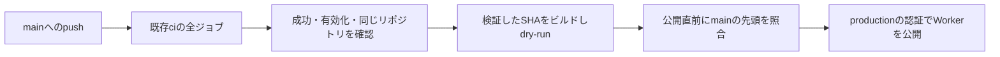

# 検証済みのmainを公開するCDの設計

## Overview

既存の`ci`全体が成功した後、別のワークフローから既存のCloudflare Workerへ公開する。保守者が有効化するまでCDは省略される。ゲーム・画面・通信の挙動は変更しない。

## Boundary Commitments

- **This Spec Owns**: 公開条件、実行中の公開の直列化、公開前検証、認証設定と導入・停止・復旧手順。
- **Out of Boundary**: ゲーム、画面、通信、依存更新、独自ドメイン、プレビュー、外部設定と初回公開の実行。
- **Allowed Dependencies**: 既存CI、`.nvmrc`のNode 24、npm workspaces、固定済みWrangler 4.151.0とGitHub公式Actions、runner標準のGitHub CLI。
- **Revalidation Triggers**: CI名・対象ブランチ・認証設定名・Worker名・ビルドコマンド・DO migrationを変えたら、CD条件と運用手順を再検証する。

## Architecture

CIとCDを分け、CIの`cancel-in-progress`が進行中の公開を中断しないようにする。CDは独自のjob concurrencyを使い、同じ公開先を直列化する。新規の依存や汎用デプロイツールは導入しない。

## File Structure Plan

| 対象 | 変更と責任 |
|---|---|
| `.github/workflows/cd.yml`（新規） | 検証されたSHAの選択、公開条件・認証・直列化を管理 |
| `.github/workflows/ci.yml` | 既存ビルドの直後にWorkerのdry-runを追加 |
| `package.json` | ルートに`deploy`と`deploy:dry-run`を追加し、必ずビルドから実行 |
| `docs/deploy.md`（新規） | 初期設定、有効化、停止、再実行、ロールバックを記載 |
| `docs/operate.md`, `docs/README.md` | 公開手順の参照先を統一 |
| `README.md`, `README.ja.md` | 運営者向けの導線を追加。未公開のデモを公開済みと表示しない |
| `.agent-harness/runs/2026-10-18-cd/validation.md`（新規） | 検証結果と未実施の外部操作を記録 |

## Components and Interfaces

| Component | 要件 | 契約 |
|---|---|---|
| CDワークフロー | 1.1, 1.2, 1.3, 1.4, 2.1, 2.2, 2.3, 2.4, 3.2 | 下記のEvent・Batch契約 |
| 公開前の検証 | 3.1, 3.3 | ビルド→既存workspaceの`deploy -- --dry-run`。失敗は非ゼロ終了 |
| 運用文書・検証記録 | 4.1, 4.2, 4.3 | 設定の登録先・操作・検証済みの範囲を示す |

### CDワークフローのEvent・Batch契約

- `workflow_run`の`completed`、`workflows: [ci]`、`branches: [main]`を購読する。手動CDは追加しない。
- job開始条件は、repository variableの`CD_ENABLED == 'true'`、元CIの`success`・`push`・`main`・同じ`head_repository.full_name`。PR・定期・手動CIは対象外。
- checkoutには元CIの`head_sha`を使い、認証情報は永続化しない。npmキャッシュの復元・保存はCDで行わない。
- `npm ci`と`npm run deploy:dry-run`を公開用認証なしで実行する。
- 公開直前に`gh api repos/$GITHUB_REPOSITORY/git/ref/heads/main`で先頭SHAを取得する。取得失敗は終了、SHA不一致はnoticeを出して公開を省略する。
- 公開jobは`environment: production`。認証は`CLOUDFLARE_API_TOKEN`と`CLOUDFLARE_ACCOUNT_ID`をEnvironment secretsから取得し、公開stepだけに渡す。
- 不足する認証の設定名だけをerrorに出す。値は出さない。公開は固定済みworkspaceのWranglerを使い、コミットSHAをmessageに記録する。
- `contents: read`だけを付与する。GitHub CLIに必要なtokenは先頭確認stepだけに渡す。
- job concurrencyは`cd-production`、`cancel-in-progress: false`、タイムアウト20分。無効・不適格なrunは公開jobを開始しない。
- 実行中にmainが進む可能性は照合時点まで扱う。公開開始後の中断や、DOの保存状態の巻き戻しは行わない。

### 初期設定と復旧

`production` Environmentに2つのsecretsを登録し、mainだけに公開を許す。repository variableの`CD_ENABLED=true`で有効化する。値の登録と公開は本人の明示指示後に行う。
有効化後はmainのpushまたはそのpush CIの再実行で公開する。定期・手動CIでは公開しない。停止は`CD_ENABLED=false`とし、すでに始まった処理の扱いも文書に示す。
復旧はCDを停止してから、既存Wranglerのdeployment一覧とrollbackを使う。DO migrationをまたぐrollbackの制約と、データを巻き戻さない点を公式文書へ案内する。

## Testing Strategy

- ワークフロー構文・式・シェルを検査し、有効/無効、CI失敗・中断、PR・定期・手動、別リポジトリを含む条件の判定を確かめる（1.1, 1.2, 2.1）。
- 実際の先頭確認・公開stepを、GitHub CLIとnpmを置き換えたローカル検証で実行する。先頭一致・不一致・取得失敗・認証不足について、公開コマンドが呼ばれる条件と終了状態を確かめる（1.3, 2.2, 3.2）。
- `npm run deploy:dry-run`で静的ファイルと実Workerのバンドルを作る（3.1, 3.3）。型・単体/結合・文書/権利/依存・容量の既存検査も行う。
- 実装者と別の担当が差分をレビューし、直列化、checkout SHA、認証の渡し先を確認する（1.4, 2.3, 2.4）。
- GitHubでのCD実行と本番公開は未実施として記録する。画面の変更はなく、UI採点や全ブラウザE2E・全変異試験の再実行は今回のローカル検証に含めない（4.3）。
