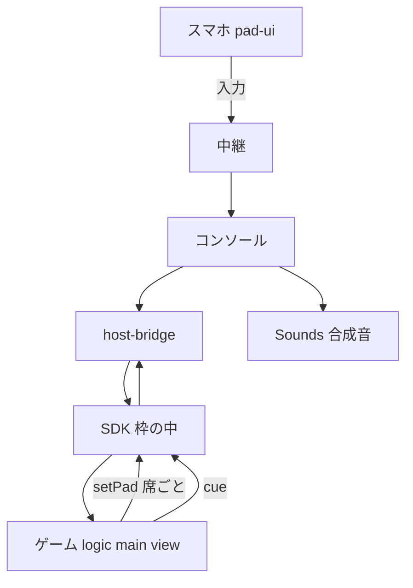

# 設計：パーティーパック（第2弾）

## Overview
4本のゲーム（ストライク横丁・大富豪・ババ抜き・月夜の村）と、手札・投票のための `tiles`、効果音の依頼 `cue-v1` を足す。ゲームは既存と同じく、隔離した枠の中の「純粋な判定（`logic.js`）＋ SDK への接続（`main.js`）＋ 描画（`view.js`）」で作る。背景は [brief.md](brief.md)、契約は [design-contracts.md](design-contracts.md)、規則は `game-*.md`、判断と出どころは [research.md](research.md)。

### Goals / Non-Goals
- Goals：7本から11本へ。8人が10分以上遊べる定番を足す。秘匿を試験で守る。既存7本を変えない。
- Non-Goals：オンライン対戦、CPU、賭け、傾きでの投球、公開デモの再デプロイ、既存ゲームの改修。

## Boundary Commitments
- **This Spec Owns**：4本の `games/*`、`registry/games/*` と画像、`tiles` と `cue-v1` の契約と実装（protocol・pad-ui・sdk・host-bridge・host の `audio.ts`・registry のスキーマ）、棚と文書の更新、新しい試験・変異・検証の記録。
- **Out of Boundary**：通信の方式と部屋の仕組み、既存7本の挙動、結果画面と再戦の仕組み、参加と共有、Cloudflare の設定と公開。
- **Allowed Dependencies**：`@irori/*` の既存パッケージだけ。依存の向きは protocol → room・pad-ui・host-bridge → sdk → games。ゲームは SDK だけを読み、ほかのゲームを読まない。新しい外部依存は足さない。
- **Revalidation Triggers**：`LIMITS` の変更、`GamePadSpec` と `InputEvent` の形、`CUES` の一覧、能力の名前、SDK の容量の上限、棚の並びの決まり。

## Architecture
既存：ホストの画面が部屋を持ち、ゲームは `MessagePort` で SDK と話す。スマホの画面は `pad-ui` が定型の種類から描く。検証は protocol の関数をスマホ・中継・橋・SDK が共有する。この形を変えない。

- 判断：`tiles` は `choices` を広げず、別の種類にする（旧ホストの検証が未知のキーを拒むので、能力で守れる）。音はゲームの枠の中でなく、コンソールが鳴らす（枠は自動再生の制限に当たる）。判断の詳細は research.md。
- 技術：新しい依存なし。SDK の生の上限を60,000→72,000バイトにする（design-contracts.md）。

## File Structure Plan
- `packages/protocol/src/{types,limits,validate,bridge}.ts`：型・上限・検証・`CUES`・能力（実装済み）。`tests/{validate,fuzz}.test.ts` に tiles を足す。
- `packages/pad-ui/src/{pad.ts,pad.css}`：`Tiles` の描画と日英の文言。`packages/host-bridge/src/{manifest,validate,frame}.ts`：`PADS`、cue の検証、能力の申告。
- `packages/sdk/src/{core,types,index,mock}.ts`・`mock.css`・`irori.d.ts`：能力の判定、`cue()`、仮想プレイヤーの tiles。
- `apps/web/src/host/{console,audio,icons,view-home,messages}.ts`：cue を鳴らす、合成音、棚の印。`apps/web/src/styles/pad.css`、`apps/web/src/pad/messages.ts`。
- `registry/schema/game.schema.json`（`pads` に tiles）、`tools/{check-budgets,make-thumbs}.mjs`、`tsconfig.games.json`（新ゲームのファイル）。
- `games/strike-alley/`：`logic.js` `physics.js` `gesture.js` `scoring.js` `view.js` `main.js` `index.html` `style.css` `README.md` と各 `*.test.js`。
- `games/{daifugo,old-maid}/`：`logic.js` `cards.js`（判定）と `view.js` `main.js` `index.html` `style.css` `README.md`。`games/moon-village/`：`logic.js` `roles.js` と同じ画面の5ファイル。
- `registry/games/{strike-alley,daifugo,old-maid,moon-village}.json`、`registry/thumbs/*.jpg`（640×480・122,880B以下）。
- 試験：`tests/e2e/console/party-pack.spec.ts`（実ホスト＋スマホ）、`tools/mutations/specs/party-pack-<id>.json`（ゲームごと）、固定の棚順（`tests/e2e/console/playtest.spec.ts`・`apps/web/tests/host/play-layout.e2e.ts`）と能力の完全一致（`packages/sdk/tests/mock.test.ts`・`packages/host-bridge/tests/timeouts.test.ts`）の更新。
- 文書：`docs/{pad,protocol,sdk,architecture,security,ux,known-issues,README}.md`、`docs/decisions/0009-party-pack-platform.md` と 0004 の追記、`README.md`・`README.ja.md`、`.agent-harness/runs/2026-10-27-party-pack/`。

## Requirements Traceability
| 要件 | 担う部品 | 契約・試験 |
|---|---|---|
| 1.1 1.2 1.3 1.4 | registry・棚・各ゲームの README | 登録の検査、棚順の試験、既存7本の試験が無改変で通る |
| 2.1 2.2 2.3 2.7 | pad-ui `Tiles`、mock | design-contracts.md の動作、単体と実ブラウザ |
| 2.4 2.5 2.6 | sdk `setPad`、protocol の検証、再接続 | 旧ホストの試験、不正入力の fuzz、再接続の試験 |
| 3.1 3.2 3.3 | sdk `cue`、host-bridge、`audio.ts` | `CUES`、`OfflineAudioContext` の描画試験 |
| 4.1 4.2 4.3 4.4 | 各 `logic.js` の公開用の型と席ごとの効果 | 公開データの走査、複数スマホの受信フレームの試験 |
| 5.1 5.2 5.3 5.4 5.5 | 各 `logic.js` の `blockers` と退出の扱い | 退出・切断・一時停止・再戦の試験、`end` は1回 |
| 6.1 6.2 6.3 6.4 | 各 `view.js` と `style.css` | 3幅の画像、axe、CPU4倍の再実行 |
| 7.1 7.2 7.3 7.4 7.5 7.6 | strike-alley の4部品 | [game-bowling.md](game-bowling.md) |
| 8.1 8.2 8.3 8.4 8.5 8.6 | daifugo の判定と画面 | [game-daifugo.md](game-daifugo.md) |
| 9.1 9.2 9.3 9.4 9.5 | old-maid の判定と画面 | [game-old-maid.md](game-old-maid.md) |
| 10.1 10.2 10.3 10.4 10.5 10.6 10.7 | moon-village の判定と画面 | [game-werewolf.md](game-werewolf.md) |
| 11.1 11.2 11.3 11.4 11.5 | 検査・変異・記録・評価 | `npm run check`、権利の記録、採点表 |

## 担当の分け方（境界の名前＝タスクの `_Boundary:_`。所有する場所は重ならない）
| 境界 | 実行者 | 所有（編集してよい場所） | 依存 |
|---|---|---|---|
| Protocol・統合 | メイン | `packages/protocol/src`、仕様、ADR、`tsconfig.games.json`、`tools/make-thumbs.mjs`、固定の棚順と一覧の試験、`README*`、`registry/thumbs`、`tests/e2e/console/party-pack.spec.ts` | なし |
| PadUi | Codex | `packages/pad-ui`、`apps/web/src/{pad,styles}`、`apps/web/tests/pad` | Protocol |
| SdkBridge | Codex（PadUiのあと） | `packages/{sdk,host-bridge}`（`dist` を除く）、`packages/{protocol,room,room-client}/tests`、`registry/schema`、`apps/web/src/host/{icons,view-home,messages}.ts`、`docs/*`、`tools/playtest-server.mjs` | PadUi |
| ConsoleSynth | Codex（SdkBridgeのあと） | `apps/web/src/host/{console,audio}.ts`、`apps/web/tests/host`、cue に関わる `packages/{sdk,host-bridge}` と `docs/*` | SdkBridge |
| DaifugoLogic / OldMaidLogic / MoonVillageLogic | Codex ×3 | `games/<id>/{logic,cards,roles}.js` と試験、`tools/mutations/specs/party-pack-<id>.json` | Protocol |
| StrikeAlleyCore | Opus | `games/strike-alley/{scoring,gesture,physics}.js` と試験 | Protocol |
| StrikeAlleyGame | Opus（Coreのあと） | `games/strike-alley/{logic,main,view}.js`・`index.html`・`style.css`・`README.md`・試験、`registry/games/strike-alley.json`、変異の仕様1本 | Core |
| DaifugoView / OldMaidView / MoonVillageView | Opus（同時2体まで） | `games/<id>/{index.html,style.css,main.js,view.js,README.md}`、`registry/games/<id>.json` | SdkBridge・ConsoleSynth・各Logic |
- 生成物（`games/*/irori.js`・`irori.d.ts`・`apps/web/public/**`）は同期ツールが作る。ビルド→同期は PadUi・SdkBridge・ConsoleSynth・メインだけが行い、ほかは編集しない。
- 共有する文書と能力の完全一致の期待値は、SdkBridge→ConsoleSynth→メインの順に所有を引き継ぐ。能力を足す担当が同時に期待値を更新する（`pad-tiles-v1`、`cue-v1`）。
- サムネイル：画面の担当は撮影の手順（操作と待ち時間）を報告に書く。メインが撮影の道具に足して撮る。人狼は4人以上で撮る。
- 試験の扱い：既存7本の挙動の試験は変えない。棚順と件数を固定した一覧の試験は、11本に更新する（メインが所有）。
- 通信の型と上限は Protocol だけが変える。進め方は3周まで、同じ指摘が2周続いたら人に返す。Codex が使えなければ同じ指示書を Opus に渡す。

## Error / Security / Testing
- 失敗：検証に通らない入力は状態を変えず無視。能力が無い旧ホストでは更新案内。cue は黙って捨てる。
- 秘匿：役・手札・夜の行動は `setPad(spec, 席)` だけで送る。公開用の型と生の型を分ける（要件 4）。
- 試験の順：型 → 単体（判定の全探索・保存則・無作為な対戦）→ 実Worker → 実ブラウザの通し（Chromium・WebKit）→ 検査 → 変異 → 供給（監査・REUSE）。新しい試験は、わざと壊して赤くなることを確かめる。

## 参考にした資料
本人がスターを付けた `awesome-gamedev-agent-skills`（Apache-2.0）から、考え方だけを取り入れた（札は「1枚は必ず1か所」の保存則、物理は固定刻みと再生の分離とすり抜け対策、手触りは小さな反応の重ね方と重要度の段階）。コードと文は写していない。
