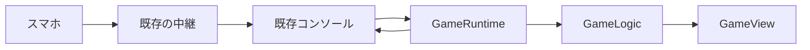

# 詳細設計：せーので10秒

2026-10-18。要件・設計の承認後、本人の指示で実装した。全体回帰検証・独立試遊・UI評価は合格。[検証記録](../../../.agent-harness/runs/2026-10-18-ten-seconds/validation.md)。

## Overview
飲み会や友人の集まりで、共用画面の合図から10秒を数え、各自のスマホで1回押す。
iroriに同梱ゲーム `ten-seconds` を追加し、参加・席・結果操作・共有を引き継ぐ。

### Goals
2〜8人・3ラウンド。記録を伏せて一斉発表し、表示したズレの合計で同順位まで決める。
中断した試行だけを破棄し、過去の確定記録を残す。

### Non-Goals
時計同期、端末内計時、新しい部屋・認証、保存ランキング、音源、アプリのデプロイは含まない。

## Boundary Commitments
### This Spec Owns
追加ゲームのルール・画面・登録・検証と、その成立に必要な終了表示・環境通知の追加契約を持つ。
### Out of Boundary
Worker・部屋管理・WebSocketの形式、固定6種の入力、既存4本のルールを変更しない。
### Allowed Dependencies
ゲームは同梱SDKだけを使う。UIはゲーム判定へ命令し、判定はDOM・通信へアクセスしない。
既存の `protocol → sdk/host-bridge → web` の依存方向を守る。
### Revalidation Triggers
終了データ、環境通知、SDKの公開型、結果の順位付けが変われば、host・mock・既存4本を再確認する。

## Architecture
既存の「ホストがゲーム状態を持つ」構成を使う。時刻を引数で渡す純粋なGameLogicを主判定にする。

### Technology Stack
| 対象 | 選択 | 変更 |
|---|---|---|
| ゲーム | 素のJavaScriptとJSDoc、HTML、CSS、DOM | 既存同梱ゲームと同じ。新規依存なし |
| 共通契約 | TypeScript、SDK 0.1.0の既存構成 | optional追加。BRIDGE_VERSION・registry sdkは1を維持 |
| 時計・保存 | 同じiframeのperformance.now、勝負中のメモリ | 通信遅れ込み。保存・計測値の外部送信を増やさない |

## File Structure Plan
| Module | 主なファイル | 責任 |
|---|---|---|
| GameLogic | `games/ten-seconds/logic.js` | 計時・受付・採点・中断・終了 |
| GameRuntime | `games/ten-seconds/main.js` | SDKとの接続と副作用 |
| GameView | `games/ten-seconds/view.js`、`style.css`、`index.html` | 公開用の画面モデルだけを描画 |
| EndContract | `packages/protocol/src/bridge.ts`、`end.ts` | 終了・環境の型、終了データの共通検証 |
| HostAdapter | `apps/web/src/host/console.ts`、`results.ts`、`view-panels.ts` | 環境通知と既存結果画面への接続 |

新規・変更・生成物・試験の全パスは[file-plan.md](file-plan.md)で固定する。

## Components and Interfaces
- GameLogicは `createGame(init)`・`updateGame(state,event)`・`publicView(state)` を公開する。[状態と契約](game-design.md)を正本とする。
- GameRuntimeはplayers・input・pause/resume・environmentを判定へ渡し、返ったpad/end効果だけを実行する。
- SDKに `environment`・`capabilities` と環境イベント、`end(results?,options?)` を追加する。
- 終了行に `ranked?:boolean`、optionsに `display`・`outcome`・`note` を加える。既定は従来どおり。
- 環境通知は接続・表示のスナップショット。メニュー用pause/resumeと分ける。[共通契約](integration-design.md)に型・順序・互換性を定義する。

## System Flows
開始・確定・中断の遷移は[game-design.md](game-design.md)、画面と進行操作は[ux.md](ux.md)を参照する。
第3回も全員の秒数と差を発表し、リーダーの「総合結果へ」で既存コンソールへ終了データを渡す。

## Data Models
1勝負に固定参加者2〜8席、最大3回の確定記録、現在の試行1回を持つ。試行はnonceと連番で識別する。
0.1秒単位の整数を採点の正本にし、表示と順位の計算に異なる丸めを使わない。

## Requirements Traceability
| Requirement | Summary | Components | Interfaces | Flows |
|---|---|---|---|---|
| 1.1, 1.2, 1.3, 1.4, 1.5 | 参加・説明・開始待ち | GameLogic, GameView, HostAdapter | players, leader, pad | intro |
| 2.1, 2.2, 2.3, 2.4, 2.5, 2.6, 2.7 | 合図・秘匿・1回受付・締切 | GameLogic, GameRuntime, GameView | frame, press, publicView | countdown/counting/reveal |
| 3.1, 3.2, 3.3, 3.4, 3.5, 3.6, 3.7 | 採点・同順位・退出 | GameLogic, EndContract, HostAdapter | end, ranked, note | reveal/ended |
| 4.1, 4.2, 4.3, 4.4, 4.5 | 次へ・総合結果・再戦 | GameLogic, GameView, HostAdapter | leader action, end | reveal/ended |
| 5.1, 5.2, 5.3, 5.4, 5.5, 5.6, 5.7, 5.8 | 中断・復帰・人数不足 | GameLogic, GameRuntime, HostAdapter | players, menu, environment | recover/ended |
| 6.1, 6.2, 6.3, 6.4, 6.5 | 操作・視認性・動き | GameView, HostAdapter | publicView, pad, result rows | 全画面 |
| 7.1, 7.2, 7.3, 7.4 | 登録・権限・共有 | GameRuntime, HostAdapter | existing join/share | intro/ended |

## Error Handling
人数不足は開始前なら説明のまま待ち、開始後なら全員順位なしで終了。中断の重複で二重減点・二重終了をしない。
必須機能を持たない古いホストでは開始を出さず、本体を更新して開き直す案内を表示する。

## Testing Strategy
丸め・締切・旧試行・重複・中断を判定の単体試験、終了契約をSDK/hostの結合試験で確認する。
実ホストとスマホ複数台で秘匿・3回の発表・再戦・複合中断を通す。[対応表と検証計画](verification-design.md)。

## Security and Performance
共有は既存の公開ホームURLだけ。部屋コード・参加者名・記録を共有文へ入れない。
文字列はtextContent、同梱CSPを維持する。計測中は無音・静止画面、SDKへ毎フレーム送らない。
SDK raw 60KiB上限と、既存build試験のより厳しい60,000B上限を両方維持する。追加前は57,786B。

## Supporting References
既存仕様は[SDK](../../../docs/sdk.md)・[通信](../../../docs/protocol.md)・[UX](../../../docs/ux.md)。
選択理由・比較・出典は[調査](research.md)。実装の順序と現在地は[tasks](tasks.md)に残す。
