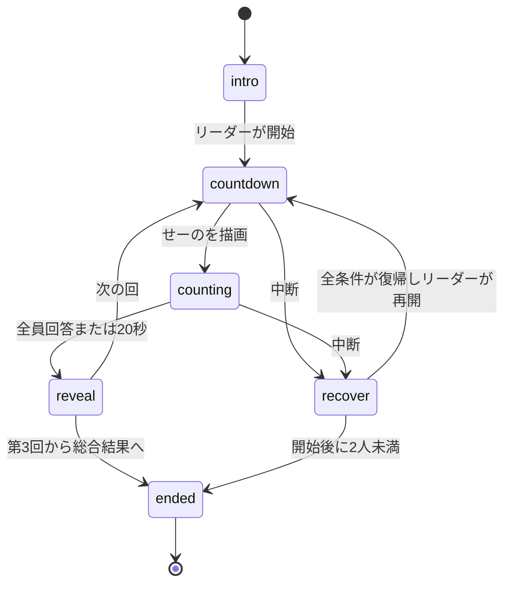

# ゲーム判定と進行の契約

要件1〜5を実現する設計。承認済みの[tasks](tasks.md)に沿って実装・検証する。

## GameLogicのInterface
`createGame(init): Transition` は初期スナップショットから状態と最初の効果を作る。
`updateGame(state,event): Transition` は1イベントを処理し、新しい状態と効果を返す。
`publicView(state): GameViewModel` は公開してよい情報だけを返す。GameViewへ生の状態を渡さない。

```ts
type Phase = 'intro' | 'countdown' | 'counting' | 'reveal' | 'recover' | 'ended';
type GameEvent =
  | { t:'frame'; nowMs:number }
  | { t:'press'; nowMs:number; p:PlayerId; id:string; down:boolean }
  | { t:'players'; nowMs:number; players:readonly PlayerInfo[]; leader:PlayerId|null }
  | { t:'environment'; nowMs:number; value:HostEnvironment|null }
  | { t:'menu'; nowMs:number; paused:boolean };
type GameEffect =
  | { t:'pad'; to:PlayerId; spec:PadSpec }
  | { t:'end'; results:GameResult[]; options:GameEndOptions };
type Transition = { state:GameState; effects:readonly GameEffect[] };
```

型名は同梱SDKの宣言型を参照する。JavaScriptではJSDocの判別可能なunionで同じ契約を表す。
初期値は参加者・leader・environment・paused・nonce・nowMs。DOM、通信、Date.nowは判定へ持ち込まない。
frameのnowMsは同じiframeの単調時計。入力受信時にも同じ時計を読む。サーバー時刻Tで差を取らない。

## Data Models
| データ | 内容・不変条件 |
|---|---|
| GameState | phase、roundIndex 0〜2、attemptSeq、nonce、現在の試行、確定した最大3回、固定参加席、leader、blockers |
| SeatState | 最初のid/name、online、退出済み。途中参加者や再利用された席を追加しない |
| TrialRecord | stopped＝elapsedMs/tenths/deltaTenths/errorTenths、またはtimeout＝errorTenths 100 |
| blockers | menu、host-offline、hidden、player-offline。全て解消するまで開始・再開操作を出さない |
| recoverTarget | intro／同じラウンドの再試行／確定済みのreveal。中断前に戻す場所を保持 |
| controlSeq | リーダー用操作の世代。新しい進行操作の提示・中断・役割変更で、古い操作IDを失効させる |

## System Flows


結果中の中断はrevealを保持して「次へ」を止める。説明中はintroを保持して開始を止める。
復帰だけで自動計測をしない。メニューを閉じた後も、ゲーム内の再開操作を待つ。
2人未満は開始前なら待機、開始後なら未成立で終了。全員退出でも元の席の記録を終了データに残す。

## 合図と入力受付
開始予告に3・2・1を1秒ずつ出す。画面へ「せーの」を反映するフレームをgoAtMsとする。
先にスマホへ案内用の1ボタンpadを配り、GOで試行専用の停止IDへ替える。案内のIDは停止として受けない。
停止IDは `s_<勝負nonce>_<試行連番>`、24文字以内。同じラウンドのやり直しでも連番を進める。
実行中であっても、違うID、知らない席、切断中、退出済み、down=false、回答済みは無視する。
有効なのはゲーム受信時の `0 <= nowMs-goAtMs < 20000`。境界20,000msでは入力より締切を優先する。
リーダーの開始・次へ・再開・総合結果の操作も、現在のleaderとcontrolSeqが一致したdownだけを受ける。
新しい進行操作を提示するたびにcontrolSeqを更新し、1回の受理でそのIDを消費する。再描画だけでは更新しない。
離し入力、押しっぱなしの画面差し替え、前の回の遅延入力は、次の回の得点や進行を変えない。

## 採点と確定
stoppedは `tenths=floor((elapsedMs+50)/100)`、`deltaTenths=tenths-100`、`errorTenths=abs(deltaTenths)`。
例：9,949ms→9.9秒・ズレ0.1秒、9,950ms→10.0秒・ズレ0.0秒、10,050ms→10.1秒・ズレ0.1秒。
timeoutは実測秒数なし・採点用のズレ10.0秒。19,999msの有効回答が20.0秒表示になってもtimeoutとは区別する。
全員回答または締切で、現在の試行を1回だけ確定記録へ移す。第3回の記録もrevealで一斉公開する。
各回の順位はその回のerrorTenthsが小さい順。退出者は順位なしで、同値は同順位にする。
累計はerrorTenthsの整数和。最終順位の対象は3回確定した退出していない人、同点は1・1・3方式。
コンソールへはscore＝累計の負値、label＝「合計ズレ 0.4秒」。退出者はranked=falseで部分記録を残す。
未成立は全員ranked=false・outcome=incomplete。未計測と途中累計を区別し、全員を優勝対象から外す。

## 中断の順序
開始予告・計測中にblocker発生または直接退出・除外：試行の受付を閉じ、未確定の全員分を破棄してrecoverへ。
過去の確定記録・席のidentityは保持し、復帰時は新しい停止IDで同じroundIndexをやり直す。
席の猶予60秒はiroriの名簿に従う。新ゲームが別の60秒タイマーで席を消さない。
一時切断はonline=falseのまま保持。名簿から席が消えた時だけ退出にする。
結果確定後の切断ではその記録を取り消さず、次の回の開始を待たせる。
endedは終端。効果endは1回だけ。GameRuntimeは購読・描画ループを解放し、SDKの結果操作へ渡す。

## 非公開情報の境界
countingのGameViewModelには秒数・記録・押した席・回答人数を含めない。DOM属性や読み上げにも出さない。
本人のpadだけを受付済みに替える。他人や全員への振動・音は出さない。
ログへ各自の名前・記録を追加しない。1勝負の状態は終了・破棄時に解放し、storageへ保存しない。
