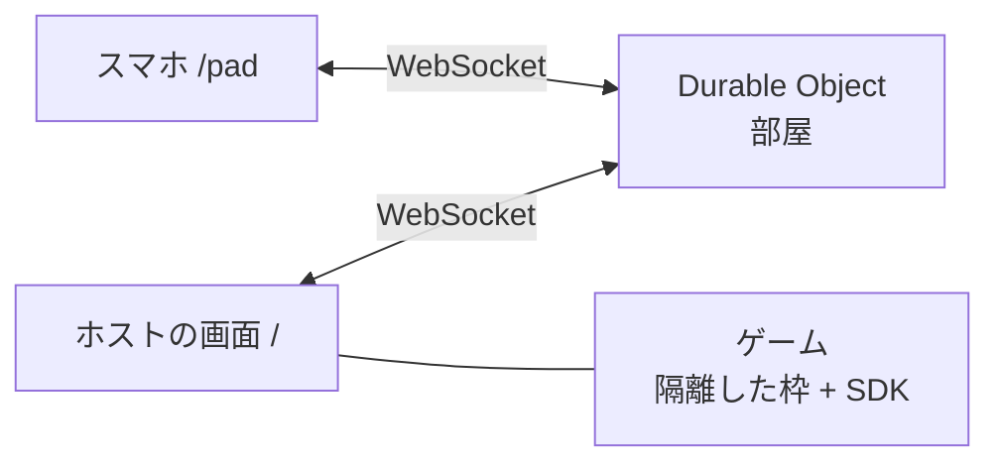

# irori（囲炉裏）

1つの大画面を囲んで、スマホをコントローラーにして遊ぶ、オープンソースのWebゲーム機です。インストールもアカウントも要りません。ホストの画面にQRコードが出て、スマホで読むだけで参加できます。ゲームは、登録情報のJSONをPRで足すだけで棚に並びます。いまは **最初のアルファ版** です。

[](https://github.com/haranishi/irori/actions/workflows/ci.yml)

> **English:** [README.md](README.md). Documentation is in Japanese (English translations welcome).

## 3分で試す

```
git clone https://github.com/haranishi/irori
cd irori
npm install
npm run dev
```

表示された「大画面で開くURL」を、PCやTVのブラウザで開きます。スマホは同じWi-Fiにつなぎ、画面のQRコードを読んで「参加する」を押します。同梱のゲーム4本（`hello-pad` `tap-race` `quiz-4` `dot-grab`）が遊べます。Node 24 以上が要ります。

傾きのセンサーを使うゲームは、スマホ側がHTTPSでないと動きません。手順は [docs/operate.md](docs/operate.md) にあります。

## 設計で大切にしていること

1. **準備ゼロで入れる。** 基準は、ホストの画面を開いてから15秒で最初のゲーム。
2. **ゲームを作る人に、通信の仕事を渡さない。** 制作者が覚えるAPIは9個。
3. **1人でも運営できる。** 部屋・接続・メッセージ・1日の部屋数に上限があり、自分のWi-FiでもCloudflareでも動く。
4. **ゲームもスマホも信用しない。** ゲームは隔離した枠で動き、届いたフレームはすべて検証する。
5. **借りるのは体験の型だけ。** 見た目・音・言葉は自分で作る。

理由と、作らないと決めたものは [理念](docs/philosophy.md) にあります。

## 機能の状況

| 機能 | 状態 |
|---|---|
| QRと4文字のコードで参加、最大8席、再接続（60秒） | アルファ |
| コントローラー6種（十字・スティック・ボタン、早押し、選択、タッチ、傾き、待機） | アルファ |
| 隔離枠でのゲームの実行、登録情報のPR、CIでの検査 | アルファ |
| 共有（X・LINE・共有シート・リンクのコピー）、OGP | アルファ |
| 同梱のゲーム4本（`hello-pad` `tap-race` `quiz-4` `dot-grab`）。終わり方をすべて試験している | アルファ |
| 実機（iPhone・Android）での長い試験、TVの内蔵ブラウザ | まだ。実機の報告を歓迎します。自動の試験は、Chromium と、Safari と同じ系統のエンジン（Playwright の WebKit）だけ |
| ホストの画面を、スマホの幅で開く使い方 | 正式な対応の外（崩れはしないが、見た目の採点が合格線の前後） |
| 実際に遊んで見つけた問題と、まだ確かめていないこと | [docs/known-issues.md](docs/known-issues.md)。報告も修正も歓迎します |
| コンソールの消音の設定を、ゲームの音へ伝える | まだ。同梱のゲームは音を出しません |
| WebRTCでの低遅延化 | 遅延を実測してから判断（[ADR 0002](docs/decisions/0002-websocket-first.md)） |
| アカウント・ランキング・チャット・課金・広告・解析・ゲームのアップロード | 作りません |

「アルファ」は、自動の試験が通っている状態です（単体・結合の試験、実ブラウザの通しの試験、守りをわざと壊して試験が赤くなるかを確かめる変異試験。件数はCIの表示のとおり）。人が実際に長く使った記録は、まだありません。公開デモのデプロイは、していません。画面は日本語と英語、同梱のゲームの文は日本語だけです。

## 仕組み



ゲームの状態はホストだけが持ち、サーバーは入力と画面の指示を運ぶ配管です。構成は [docs/architecture.md](docs/architecture.md)、通信は [docs/protocol.md](docs/protocol.md)、ゲームの作り方は [docs/sdk.md](docs/sdk.md) にあります。

## ゲームを足す

[docs/sdk.md](docs/sdk.md) の短いコード（HTML 3行とスクリプト12行）から始めて、`registry/games/<id>.json` を足してPRを出します。審査の基準と流れは [docs/registry.md](docs/registry.md)。

## 参加する

実機での確認の報告、ゲームの登録、文書の翻訳を歓迎します。保守者は1人で、返信の目安は1週間です。入口は [CONTRIBUTING.md](CONTRIBUTING.md)、セキュリティの報告は [SECURITY.md](SECURITY.md)、行動の基準は [CODE_OF_CONDUCT.md](CODE_OF_CONDUCT.md) にあります。

## AIと一緒に作っています

設計と実装は、AI（Claude）と一緒に進め、人が判断しています。AIが書いた部分も、試験・権利の確認・独立した読み取りのレビューを通しています。記録は [`.agent-harness/`](.agent-harness/) にあります。

## ライセンス

コードは MIT OR Apache-2.0、文書と画像は CC BY 4.0、設定と登録情報は CC0 です（[docs/legal/license-policy.md](docs/legal/license-policy.md)）。個別の権利の判断は、弁護士の確認を受けていません。商標は、各権利者のものです。QRコードは、株式会社デンソーウェーブの登録商標です。
