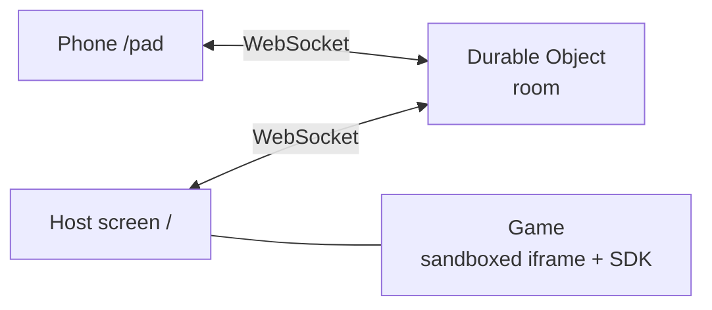

# irori

**Gather around one screen. Phones are the controllers.** irori is an open-source web game console: open it on a big screen (a laptop on a TV works), scan the QR code with phones, and play. No installs, no accounts. Anyone can add a game with one pull request. This is a **first alpha**.

[](https://github.com/haranishi/irori/actions/workflows/ci.yml)

> **日本語:** [README.ja.md](README.ja.md). The design documents are written in Japanese first; English translations are welcome (see [CONTRIBUTING.md](CONTRIBUTING.md)).

## Try it in 3 minutes

```
git clone https://github.com/haranishi/irori
cd irori
npm install
npm run dev
```

Open the printed URL on the big screen, join the same Wi-Fi with a phone, scan the QR code on the screen, and tap "Join". Eleven games are included: `hello-pad`, `tap-race`, `quiz-4`, `dot-grab`, `ten-seconds`, `blade-duel`, `lantern-market`, `strike-alley`, `daifugo`, `old-maid`, `moon-village`. Node 24 or later is required.

The new [Blade and Breath](games/blade-duel/README.md) is a two-player sword duel: choose a move in secret, manage your energy, and clash together. [Lanterns Unclaimed](games/lantern-market/README.md) is a card battle for 2–8 players: matching bids cancel out, so the highest unique card wins the lanterns. Try them on one computer at `/games/blade-duel/?mock=2` or `/games/lantern-market/?mock=3` using the on-screen controllers.

The second pack adds four games meant to last: [Strike Yokocho](games/strike-alley/README.md) is bowling you throw by pulling your finger back on the phone (1–6 players); [Hearth Daifugo](games/daifugo/README.md) (3–8) and [Hearth Joker](games/old-maid/README.md) (2–8) are card games where your hand shows only on your own phone; [Night at Hearth Village](games/moon-village/README.md) is a werewolf game with no game master (4–8). On one computer, open `/games/strike-alley/?mock=2`, `/games/daifugo/?mock=4`, `/games/old-maid/?mock=3` or `/games/moon-village/?mock=5` and use the on-screen controllers.

To try Ten Seconds Together on one computer, open `/games/ten-seconds/?mock=2` on the development server. Space controls player 1; Enter controls player 2. The [game guide](games/ten-seconds/README.md) explains the three rounds and how to resume after an interruption.

Games that use the phone's tilt sensor need HTTPS on the phone side. See [docs/operate.md](docs/operate.md).

To host your own instance on Cloudflare, follow the [deployment guide](docs/deploy.md) (Japanese) for setup, automatic deployment after CI passes, and rollback. Costs and operating limits are in [docs/operate.md](docs/operate.md).

## What it is built around

1. **Zero setup.** The goal: from opening the host screen to the first game in 15 seconds.
2. **Game makers don't write networking.** The SDK is one file and nine calls.
3. **Operable by one person.** It runs on your own Wi-Fi or on Cloudflare, with caps on rooms, connections, messages and daily room count, so the bill cannot run away.
4. **Neither games nor phones are trusted.** Games run in a sandboxed iframe; every frame is validated.
5. **Only the experience pattern is borrowed.** Look, sound and wording are original, and no code or assets were taken from any reference.

The reasoning, and the things deliberately left out (accounts, analytics, ads, payments, uploads, chat), are in [docs/philosophy.md](docs/philosophy.md).

## Status

| Area | State |
|---|---|
| Join by QR or 4-character code, up to 8 seats, reconnect within 60 seconds | Alpha |
| Seven controller kinds (pad, buzzer, choices, tiles, touch, tilt, wait) | Alpha |
| Sandboxed games, registry by pull request, CI checks | Alpha |
| Sharing (X, LINE, share sheet, copy link) and OGP | Alpha |
| Eleven bundled games, including bowling, two card games and a werewolf game; endings, leavers and rematches are tested | Alpha |
| Long sessions on real iPhones and Android phones, TV browsers | Not tested yet. Reports are very welcome. Automated tests run Chromium and WebKit (Safari's engine, via Playwright) only |
| Opening the host screen at phone width | Not officially supported (it does not break, but its visual score is around the pass line) |
| Problems found by playing, and what is not verified yet | Listed in [docs/known-issues.md](docs/known-issues.md) (Japanese). Reports and fixes are welcome |
| Sound effects (games ask for named cues; the console plays its own synthesized sounds and honors mute) | Alpha. How it sounds has not been checked by ear yet |
| Long sessions of the card, werewolf and bowling games between real people | Not yet. Tuning values (role mix, how often strikes happen) are expected to change after play |
| WebRTC for lower latency | Planned after measuring ([ADR 0002](docs/decisions/0002-websocket-first.md)) |
| Accounts, ranking, chat, payments, ads, analytics, game uploads | Not planned |

"Alpha" means the automated tests pass (unit and integration tests, end-to-end tests in real browsers, and mutation tests that break a safeguard on purpose and check that a test turns red; counts are in the CI output). Nobody has used it for long yet. No public demo is deployed. The UI is Japanese and English; the sample games' text is Japanese only.

## How it works



The host keeps the game state. The server only carries inputs and screen instructions. See [docs/architecture.md](docs/architecture.md) and [docs/protocol.md](docs/protocol.md) (Japanese).

## Add a game

Start from the short example (a 3-line HTML page and a 12-line script) in [docs/sdk.md](docs/sdk.md), then add `registry/games/<id>.json` and open a pull request. Review criteria are in [docs/registry.md](docs/registry.md).

## Contributing

Real-device reports, new games and translations are the most useful. There is one maintainer; expect a reply within about a week. Start with [CONTRIBUTING.md](CONTRIBUTING.md). Security reports: [SECURITY.md](SECURITY.md).

## Built with AI

Design and implementation were done together with AI assistants (Claude and Codex) under human direction. Tests, independent read-only reviews and rights checks were run on the AI-written parts. Records are in [`.agent-harness/`](.agent-harness/).

## License

Code: MIT OR Apache-2.0. Documents and images: CC BY 4.0. Configuration and registry data: CC0 ([details](docs/legal/license-policy.md)). The legal judgments here have not been reviewed by a lawyer. Trademarks belong to their owners ("QR Code" is a registered trademark of DENSO WAVE INCORPORATED).
