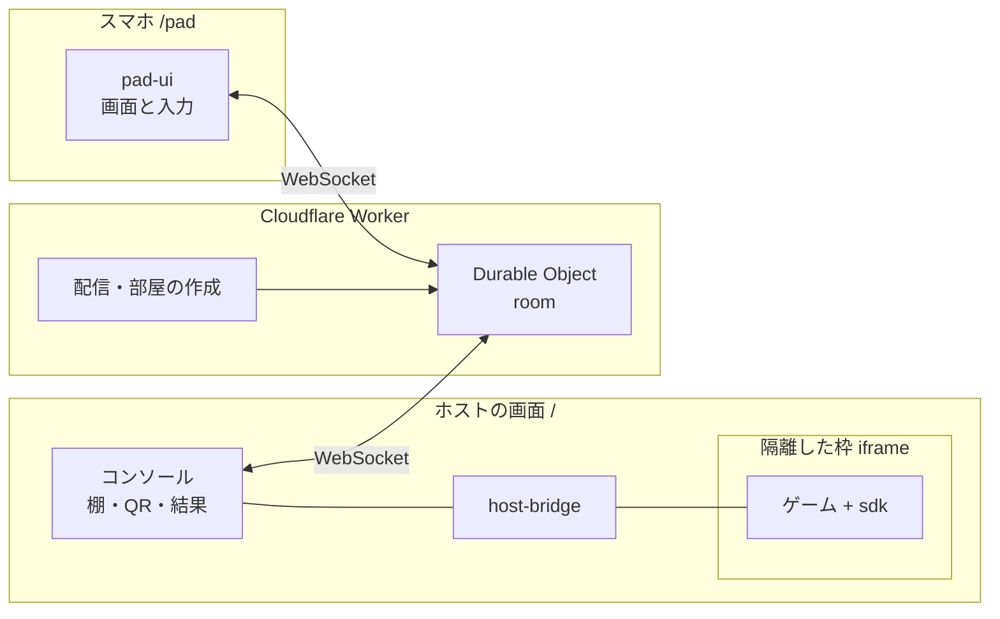

# 構成：小さな部品を、依存の向きを一方向にして重ねる

ホストの画面（コンソール）が主役で、ゲームはその中の隔離した枠で動き、スマホはWebSocketの中継を通して入力を送る。サーバーは配管に徹する。部品は9つに分け、下から上へしか依存させない。

## 部品の責任

| 部品 | 責任 | 持たないもの |
|---|---|---|
| `packages/protocol` | 通信の型・上限値・検証・部屋のコード | 入出力。ほかの部品への依存 |
| `packages/room` | 部屋の状態機械（入退室・再接続・転送・上限）。入力を受けて「やること」の一覧を返す | ネットワークと時計への直接の依存。時刻は引数で受ける |
| `packages/pad-ui` | コントローラー画面の描画と入力の取り出し（スマホ画面と、SDKの仮想プレイヤーが共有） | 通信 |
| `packages/host-bridge` | 隔離枠の作成、握手、枠とのやり取り、登録情報の検証 | 画面の見た目 |
| `packages/sdk` | ゲーム側の1ファイル。握手、イベント、仮想プレイヤー | 通信、部屋 |
| `apps/edge` | Worker。配信、部屋の作成、`room` をDurable Objectに載せる、上限の栓 | ゲームの内容 |
| `apps/web` | ホストの画面（`/`）とスマホの画面（`/pad`）。共有の部品とスタイル | サーバーの規則 |
| `games/*` | 同梱のゲーム。自分のフォルダの外を読まない | ほかの部品の内部 |
| `registry/` | 棚に並べるゲームの登録情報とスキーマ | ゲーム本体 |

## 依存の向き

`protocol` は何も読まない。`room`・`pad-ui`・`host-bridge` は `protocol` だけを読む。`sdk` は `protocol` の型と `pad-ui` を読む。`edge` は `room` と `protocol`、`web` は `protocol`・`pad-ui`・`host-bridge` を読む。部品どうしが逆向きに、または `apps/*` を読むことはない。`tools/check-deps.mjs` が `import` を機械で数えて、破れたら落とす。内部の実装を外から掴まれると、あとで直せなくなるため。

## 入力が1つ届くまで

指がボタンに触れる → `pad-ui` が `btn` を作る → スマホがWebSocketで送る → Durable Objectが大きさ・速さ・形式を検証 → 席番号と受信時刻を付けてホストへ転送 → コンソールが検証し直して `host-bridge` に渡す → 枠のゲームが `input` として受ける。検証は2回ある。サーバーを通らない経路（開発用の仮想プレイヤー）でも同じ検証が走るようにするため。

## 守る性質

- サーバーは、ゲームの規則も得点も解釈しない。
- コンソールは `Set-Cookie` を返さず、`localStorage` にはゲームごとの名前空間でしか書かせない。
- スマホとゲームから来た文字列は、`innerHTML` で描かない。
- 枠の `sandbox` に `allow-same-origin` を付けるのは、コンソールと別オリジンの外部ゲームだけ。同梱のゲームは付けずに、CORSを許したパスから配信する。同じオリジンに付けると隔離が無効になる。
- SDKは1ファイルで依存がなく、生の容量の上限（72KB。gzipは60KB）を試験で守る。

## 配信と開発

1つのWorkerが、静的ファイル（`apps/web` のビルド結果、同梱ゲーム、SDK）と `/api` を返す。`npm run dev` はLANから届くURLを表示し、大画面とスマホを同じWi-Fiに置けば遊べる。傾きのセンサーはHTTPSでないと使えないので、実機で試すときは [operate.md](operate.md) の手順に従う。

## 決めた理由

判断ごとの捨てた案は [decisions/](decisions/) にある。[WebSocketを先に](decisions/0002-websocket-first.md)、[隔離枠でゲームを動かす](decisions/0001-games-in-sandboxed-iframes.md)、[登録はPRで](decisions/0003-registry-by-pull-request.md)、[コントローラーは定型で](decisions/0004-fixed-pad-kinds.md)、[UIの部品を持たない](decisions/0005-no-ui-framework.md)、[見た目を独自にする](decisions/0006-original-identity.md)、[アカウントも解析も持たない](decisions/0007-no-accounts-no-analytics.md)。
